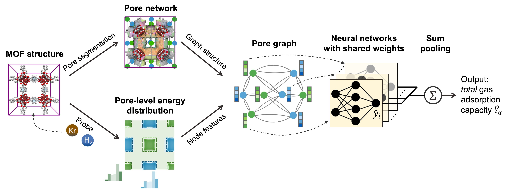

# PoroNet
PoroNet is an inherently interpretable pore graph neural network for predicting gas adsorption in metal-organic frameworks (MOFs). Its interpretability allows the extraction of quantitative contributions of individual pores to the total adsorption without the pore-level training data. PoroNet is constructed on top of pore graphs, which can be generated using code in this repo. The pore graph generation and pore-level energy histogram features will be later incorporated into our open-source structural analysis and visualization package, Mofography (unpublished). Stay tuned!  

## Instructions
This repository consists of:
1. "poronet_functions": Functions used in PoroNet.
2. "Download_Tobacco_Database": Download MOF structures from the Tobacco database through MOFXDB (mof.tech.northwestern.edu) database.
3. "Pore_Graph_Generation": Generate pore graphs for chosen MOFs.
4. "Pore_Labels_Extraction": Extract pore-level labels from RASPA2 Movie files.
5. "PoroNet&PoroNet-Base": Illustrations of PoroNet and PoroNet-Base for predicting H2 adsorption at 160 K/5 bar.
6. "Cavity_Size_Distribution_Calculation": Calculation of the cavity size distribution .
7. "Pore_Surface_Area_Calculation":Calcultion of the surface area of pores.
8. "Example_GCMC_input": Example RASPA2 simulation input files for H2 adsorption in MOFs.
9. "GCMC_output": Results of GCMC simulation for H2 adsorption in selected MOFs and pores at cryogenic conditions (160 K/5 bar, 77 K/100 bar) and room temperature conditions (298 K/5 bar, 298 K/100 bar).
10. “MOF-5.html”: an illustrative website showing the pore network structure of MOF-5.
11. "PoroNet.md": an example of PoroNet for H2 adsorption prediction and pore-level contribution extraction.

## Reference
Zheng, C.; Gopalan, A.; Shi, K. PoroNet: An Intrinsically Interpretable Pore Graph Neural Network for Resolving Pore-Level Adsorption in Metal–Organic Frameworks. J. Chem. Theory Comput. 2026, 22 (11), 5716–5730. https://doi.org/10.1021/acs.jctc.6c00100.
